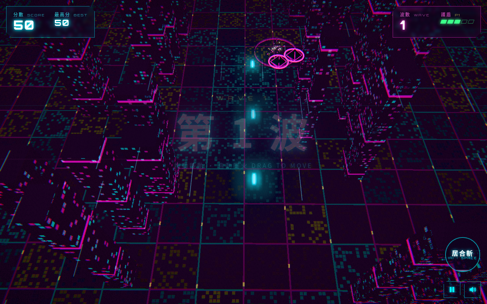

# 異域凶間 XENO NIGHTMARE

> 賽博朋克 3D 直向射擊 · cyberpunk 3D vertical shooter · 自動開火 auto-fire · Three.js · 手機優先

**試玩 Play:** https://fung2222.github.io/cyber-ninja/ · **自動示範 Demo:** https://fung2222.github.io/cyber-ninja/?demo=1



## 玩法 How to play
- 喺畫面**任何位置拖動**移動戰機（相對拖動，手指唔會遮住角色）；戰機會**自動開火**。
- **三種武器、每種 6 級**：**脈衝連發 PULSE REPEATER**（均衡散射）、**相位長槍 PHASE LANCE**（貫穿直線）、**星爆震波 NOVA SURGE**（大範圍爆炸）。執拾 **W 武器**即時換槍，**P 火力**提升目前武器一級；每種武器保留自己嘅等級同儲能。
- 每種武器有**自己嘅儲能大招**：彈幕洪流、稜鏡貫穿、奇點爆發；擊破敵機儲能量。
- **最大火力 OVERDRIVE**：按 Q／撳橙色掣，現有武器昇華 4 秒（火力同射速提升）；代價係完結後**強制停火 3 秒**，期間要專心走位。
- 敵人會用**編排隊形**（兩翼、彈牆、交叉火、衝鋒、精英）同瞄準射擊；地圖每隔幾秒有**預警激光欄**，要靠走位避開。
- 每 5 波迎戰**星海魔獸**：三個階段、每階段獨立彈幕（環形、螺旋、缺口彈牆、交叉火），血越低攻勢越密。
- 擊破敵人會跌出**寶石**，自動飛向戰機吸收；普通敵 1–2 粒、砲塔 3 粒、精英額外 4 粒、Boss 一次 18–32 粒。寶石加分數同少量儲能，唔會自動幫你換武器。
- 拾取道具：**火力 P**（升目前武器）、**護盾 S**（+1 護盾）、**能量 E**（儲大招）。**武器 W** 只會由精英、砲塔（低機率）同 Boss 掉落，**唔會自動吸向你**；要自己飛過去執。執到會換槍並將該武器升 1 級（已滿級就保持 6）。
- 機體可以飛越**全版圖**（由上到下），唔再局限下半部。
- 被擊中會失去 1 格護盾同 1 級目前武器；護盾歸零就任務失敗，可以睇廣告**復活一次**（網頁版免費）。
- **無盡模式**：波數永遠唔會完。每個巨獸週期都會出新品種（深淵魔眼、等離子海妖……之後 Mk.2、Mk.3 變種），難度曲線有上限（敵機 HP 最多 ×3.2、巨獸 HP 最多 1100、射速最多 ×1.6），確保一直玩得落去。每 10 波係**里程碑**：額外分數、護盾補滿、城市主題轉色。最遠波數會記錄為無盡紀錄。

## 語言 Language
遊戲支援**繁體中文（香港）**同 **English**，喺齒輪設定或暫停畫面切換，會記住你嘅選擇（`localStorage cyber.lang`，所有 CYBER 遊戲共用）。網址加 `?lang=en` / `?lang=zh` 亦可。

## English
**XENO NIGHTMARE** is a one-thumb 3D cyberpunk vertical shooter. Drag anywhere to move — your craft auto-fires (your finger never covers the ship) and can fly across the **whole field**. **Three weapons, six levels each:** Pulse Repeater, Phase Lance and Nova Surge. **P** raises the current weapon; **W** canisters only drop from elites, turrets and bosses, never magnetise, and upgrade the weapon you pick up. Each weapon has its own charged ultimate. **OVERDRIVE** ascends the current weapon for 4 seconds, then forces a 3-second cease-fire. Kills drop **gems** that fly into the craft automatically; bosses drop a large burst. Enemies arrive in authored formations and fire aimed patterns; telegraphed laser lanes cut across the map. Every 5 waves a **star-sea monster** boss fights in three distinct phases. **Endless mode:** capped scaling, milestone bonuses, saved best-wave record. Bilingual (Traditional Chinese / English).

## 操作 Controls
| 動作 | 手機 | 鍵盤 |
|---|---|---|
| 移動 Move | 拖動 Drag | ←→↑↓ / WASD |
| 武器大招 Weapon Ultimate | 藍色大招掣 | Space / Enter / X / J |
| 最大火力 OVERDRIVE | 橙色掣 | Q / O |
| 暫停 Pause | ⏸ | P / Esc |
| 靜音 Mute | 🔊 | M |

## 網址參數 URL flags
`?demo=1` AI 自動玩 · `?lang=en|zh` · `?fps=1` · `?quality=low` · `?adsim=1` · `?reset=1` · `?mute=1`

## 技術 Tech
Three.js r169 + [cyber-kit](https://github.com/fung2222/cyber-kit) v0.3.19（`vendor/cyber-kit/`），冇 build step，可離線運行。所有模型（戰機、敵機、星海魔獸）都係程式生成嘅原創設計；音效同音樂全部合成。

## 開發 Development
```bash
cd .. && python3 -m http.server 18940     # http://127.0.0.1:18940/cyber-ninja/
node --test cyber-ninja/tests/
python cyber-ninja/tests/weapons.py
python cyber-ninja/tests/core.py
python cyber-ninja/tests/ult-reset.py
python cyber-ninja/tests/brand.py
python cyber-ninja/tests/smoke.py
```
文件：[docs/HANDOFF.md](docs/HANDOFF.md) · [docs/DEEP-AUDIT-2026-11-03.md](docs/DEEP-AUDIT-2026-11-03.md) · [privacy.html](privacy.html) · 屬於 [CYBER ARCADE](https://github.com/fung2222/cyber-arcade) 系列。
